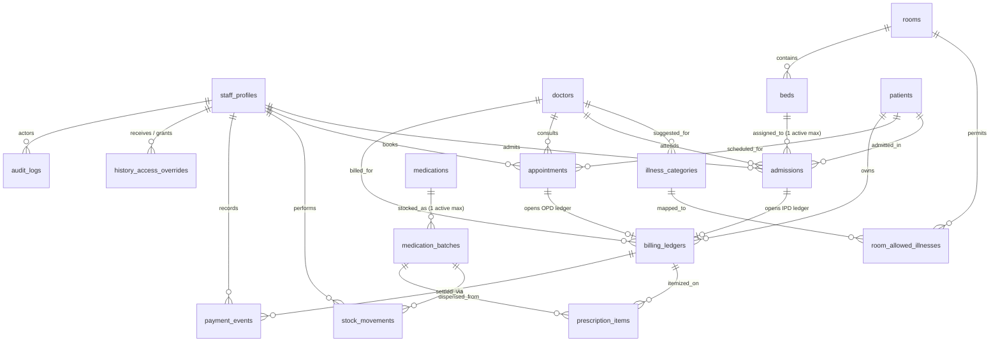

# UNICARE (Recto Medical) — Database Design & Supabase Setup Guide

## 1. Entity-Relationship Diagram (3NF PostgreSQL Schema)



---

## 2. Normalization (1NF → 2NF → 3NF)

1. **First Normal Form (1NF):**
   - Eliminated repeating nested arrays (`rooms[].beds[]`, `rooms[].allowedIllnesses[]`, `ledgers[].pharmacyItems[]`, `ledgers[].paymentEvents[]`) into atomic relational tables: `beds`, `room_allowed_illnesses`, `prescription_items`, and `payment_events`.
2. **Second Normal Form (2NF):**
   - Every table uses a surrogate single-column primary key (`bigint generated always as identity` or `uuid`), except the junction table `room_allowed_illnesses(room_id, illness_category)` which carries zero non-key attributes. No partial functional dependencies exist.
3. **Third Normal Form (3NF):**
   - **Patient identity vs. Bed/Ledger:** `patients` owns `mrn` and `full_name`; `admissions` references `patient_id` and `bed_id`, removing duplicated patient strings from beds and bills.
   - **Room vs. Bed vs. Admission:** `rooms` stores `daily_rate`, `ward_type`, and `contagious_status`; `beds` stores physical labels (`Bed A1-1`); active occupancy is derived from `admissions WHERE discharged_at IS NULL` via a partial unique index (`admissions_one_active_per_bed_uniq`).
   - **Catalog vs. Lot vs. Price Snapshot:** `medications` owns catalog attributes, `medication_batches` owns physical `batch_no`, `stock_qty`, and `expiry_date`, and `prescription_items` snapshots `unit_price_snapshot` at dispense time so future price updates never alter historical receipts.
   - **Invoices vs. Payment Events:** `billing_ledgers` holds one ledger per encounter (`admission_id`, `appointment_id`, or `walkin_ticket_code`), while `payment_events` records immutable settlement milestones (`SETTLED_PAID`, `PROMISSORY_ISSUED`, `PROMISSORY_PAID`).

---

## 3. Database-Enforced Invariants & Security Matrix

| Invariant | PostgreSQL Mechanism | Migration |
|---|---|---|
| No double-booked beds | `CREATE UNIQUE INDEX admissions_one_active_per_bed_uniq ON admissions (bed_id) WHERE discharged_at IS NULL` | `001_schema.sql` |
| Contagious & wing hard-lock | `BEFORE INSERT OR UPDATE` trigger `trg_enforce_admission_wing_rules` | `003_rpcs_and_triggers.sql` |
| Max 3 OPD patients per slot | `pg_advisory_xact_lock` + trigger `trg_enforce_opd_slot_cap` | `003_rpcs_and_triggers.sql` |
| At most 1 active batch per drug | `CREATE UNIQUE INDEX medication_batches_one_active_uniq ON medication_batches (medication_id) WHERE status = 'Active'` | `001_schema.sql` |
| Deadlock-free atomic dispense | `ORDER BY medication_batches.id ASC FOR UPDATE` inside `dispense_prescription` | `003_rpcs_and_triggers.sql` |
| Financial accounting equation | `CHECK` constraint enforcing `gross = room + doc + pharm`, `discount <= gross + surcharge`, `settled = gross - discount + surcharge` | `001_schema.sql` |
| Views respect RLS | Every analytical view declared `WITH (security_invoker = true)` | `001_schema.sql` |

### 4-Role RLS Matrix

| Role | IPD (`admissions`) | OPD (`appointments`) | Pharmacy (`medications`, `medication_batches`) | Billing Active & Promissory | Paid History & `audit_logs` |
|---|---|---|---|---|---|
| **Hospital Administrator** | Read / Write | Read / Write | Read / Write | Read / Settle | Full Read (+ Grant Override) |
| **Front Desk & Admissions Staff** | Read / Admit | Read / Book | Read-only | Active IPD/OPD auto-create only | Blocked |
| **Hospital Pharmacist** | Read-only | Read-only | Read / Restock / Dispose / Dispense | Read Active + Create OTC | Blocked |
| **Billing & Discharge Officer** | Read + Stay Days / Discharge | Read + Settle status | Read-only | Read / Settle / Promissory | Blocked unless active 30-min `history_access_overrides` row exists |

---

## 4. 3-Minute Supabase Setup Checklist

1. **Create a Supabase Project:**
   - Go to [https://supabase.com/dashboard](https://supabase.com/dashboard), click **New project**, name it `unicare-recto-medical`, set a database password, and wait ~1 minute for provisioning.
2. **Run the Database Setup SQL:**
   - Open **SQL Editor → New query** in Supabase Studio.
   - Paste the full contents of [supabase/full_setup.sql](../supabase/full_setup.sql) and click **Run**.
   - *(Optional DBA proof)* Run [supabase/verify_dba.sql](../supabase/verify_dba.sql) in a new query tab to observe all 9 transactional constraint & RLS checks pass and roll back cleanly.
3. **Seed the 4 Staff Login Accounts:**
   - In Supabase Studio, open **Project Settings → API** and copy your **Project URL**, **Publishable key** (`sb_publishable_...`), and **Secret key** (`sb_secret_...`).
   - Run in PowerShell inside this folder:
     ```powershell
     $env:SUPABASE_URL="https://YOUR_PROJECT_REF.supabase.co"
     $env:SUPABASE_SECRET_KEY="sb_secret_YOUR_SECRET_KEY"
     node scripts/seed-auth-users.mjs
     ```
4. **Connect the Frontend & Launch:**
   - Open [supabase-config.js](../supabase-config.js) and paste your `url` and `publishableKey` (never put the secret key here!).
   - Start the local server:
     ```powershell
     node serve.mjs
     ```
   - Open `http://127.0.0.1:3000/` and sign in with `admin.recto`, `frontdesk.01`, `pharmacist.01`, or `billing.01`!
